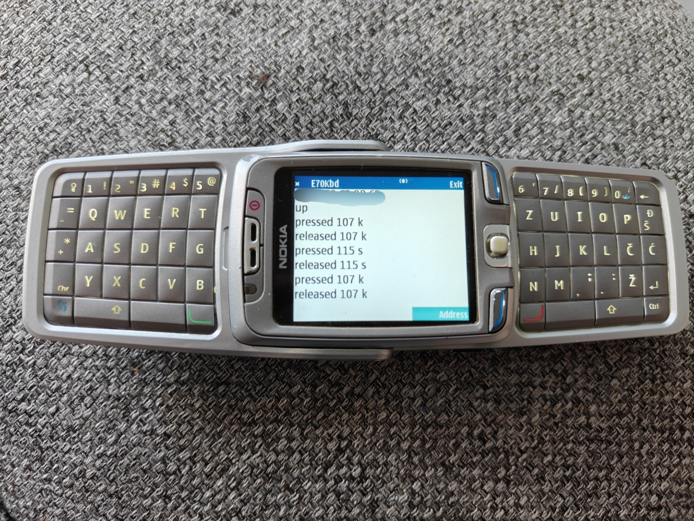

# Nokia E70 as a Bluetooth keyboard



The phone runs an unsigned Java ME MIDlet. Ubuntu runs a Go daemon that injects US QWERTY keys through `/dev/uinput`. The phone dials the PC. The PC does not scan.

The client is a MIDP 2.0 MIDlet and can run on other S60 Symbian phones. It has been tested only on a Nokia E70-1 (Symbian 9.1, S60 3rd Edition). A numeric keypad will not produce letters. The PC side was tested on Ubuntu 26.04.

## Prerequisites

### PC

- Ubuntu with BlueZ 5 and a Wayland session whose input layout is English (US).
- Go 1.25 or newer.
- JDK 11 or newer, Python 3, `curl`, and `unzip` (phone build only).
- The logged-in user must be able to open `/dev/uinput` and call BlueZ `ProfileManager1` over the system bus. Do not run the daemon as root.
- The phone is paired and trusted in the normal Ubuntu Bluetooth settings. The daemon does not pair.

### Phone

- An S60 Symbian phone with Bluetooth on. Tested only on a Nokia E70-1.
- Permission to install an unsigned MIDlet (MIDP 2.0 / CLDC 1.1).
- A way to copy `E70Kbd.jad` and `E70Kbd.jar` onto the phone together (Bluetooth file transfer or a memory card).

## How to use

1. Clone the repository and enter it.

2. Let your user open `/dev/uinput`. The rule in `socket/udev/99-e70kbd.rules` sets the owner to `USER`. Change that name if the daemon runs as another user, then:

   ```bash
   sudo cp socket/udev/99-e70kbd.rules /etc/udev/rules.d/99-e70kbd.rules
   sudo udevadm control --reload-rules
   sudo udevadm trigger --name-match=uinput
   ```

   Log out and back in if `/dev/uinput` is still not writable.

3. Pair the phone in Ubuntu Bluetooth settings and mark it trusted.

4. Build the MIDlet:

   ```bash
   make -C app
   ```

   Install `app/dist/E70Kbd.jad` and `app/dist/E70Kbd.jar`. Keep the two files together. The phone will ask to allow Bluetooth once; that is expected for an unsigned MIDlet.

5. Find the PC Bluetooth address:

   ```bash
   bluetoothctl show | awk '/Controller/ {print $2}'
   ```

6. Start one daemon, from `socket/`:

   ```bash
   go run ./cmd/kbd
   ```

   It prints the RFCOMM channel (22 on this setup) and waits. Leave it running. Do not start a second copy.

7. On the phone, open E70Kbd. Enter the PC address (12 hex digits; colons optional). The canvas must stay in front. A call, lock, or security prompt steals keys.

8. Click a text field on Ubuntu. Type on the phone. Letters, space, digits, US punctuation, Enter, and Backspace are injected. Serbian letters are shown on the phone and dropped.

Stop the daemon with Ctrl-C. It releases every injected key on disconnect and on exit.

## Notes

- The app only receives keys while its canvas is the foreground screen.
- If the phone stays on `connecting` and the daemon never prints `connected`, check that the adapter is connectable and that only one `kbd` process is running.
- `go run ./cmd/kbd -tap a` injects one `a` and exits. Use it to test `/dev/uinput` without the phone.
